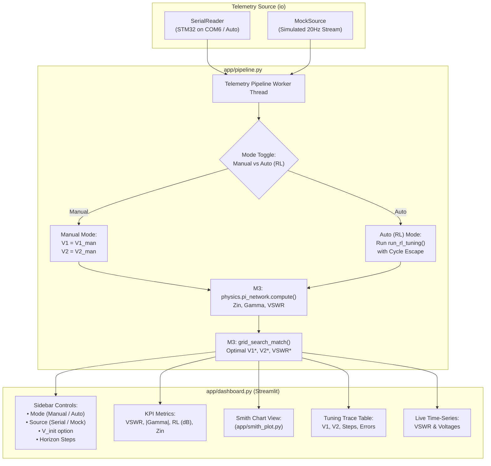
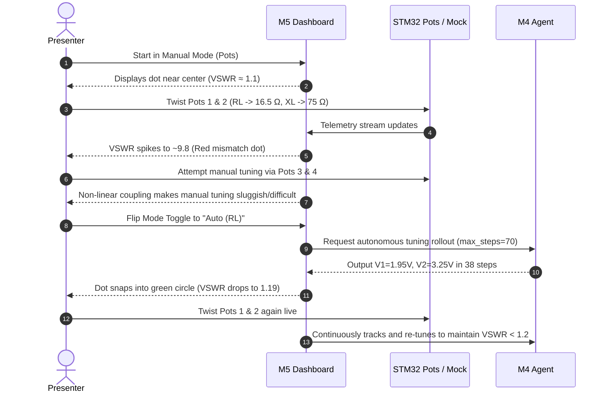

# M5 Implementation Plan: Real-Time Streamlit Dashboard & Integration

> **Objective:** Guide the implementation of Module 5 (`app/dashboard.py`, `app/pipeline.py`, `app/smith_plot.py`) to deliver the interactive Streamlit dashboard. All simulation, physics, RL inference, and hardware telemetry parameters are standardized directly against [`scripts/live_matching_monitor.py`](./scripts/live_matching_monitor.py), [`config.py`](./config.py), and verified M1–M4 modules.

---

## 1. Master System Parameters & Constants Reference

The M5 developer **must** use these exact constants across all pipeline and visualization components. Do not redefine or hardcode arbitrary values.

### 1.1 Hardware, Telemetry & Serial Link (M1 ↔ M2 ↔ M5)
| Parameter | Value | Source | Purpose |
|---|---|---|---|
| `BAUD_RATE` | `115200` | `config.BAUD` | STM32 USART2 baud rate (8-N-1) |
| `SAMPLE_RATE_HZ` | `20.0` Hz | `config.SAMPLE_RATE_HZ` | Hardware streaming rate (~50 ms period) |
| `ADC_MAX` | `4095` | `io.filters.ADC_MAX` | 12-bit ADC full-scale count ($2^{12}-1$) |
| `ADC_VREF` | `3.3` V | `io.filters.ADC_VREF` | Microcontroller analog reference voltage |
| `RL_RANGE` | `(10.0, 17.0)` $\Omega$ | `io.filters.RL_MIN, RL_MAX` | Potentiometer 1 calibrated resistance range |
| `XL_RANGE` | `(62.0, 77.0)` $\Omega$ | `io.filters.XL_MIN, XL_MAX` | Potentiometer 2 calibrated reactance range |
| `V_RANGE` | `(0.0, 3.3)` V | `io.filters.V_MIN, V_MAX` | Potentiometer 3 & 4 manual voltage range |
| `FILTER_ALPHA` | `0.25` | `io.serial_reader.DEFAULT_FILTER_ALPHA` | Exponential Moving Average (EMA) smoothing factor |
| `MEDIAN_WINDOW`| `3` | `io.filters.ChannelFilter` | Sliding-window spike rejection filter window |

#### Exact ADC Conversion Formulas
```python
RL = 10.0 + (adc_RL / 4095.0) * 7.0    # Load Resistance in Ohms [10.0, 17.0]
XL = 62.0 + (adc_XL / 4095.0) * 15.0   # Load Reactance in Ohms [62.0, 77.0]
V1 = (adc_V1 / 4095.0) * 3.3          # Manual Varactor Bias 1 in Volts [0.0, 3.3]
V2 = (adc_V2 / 4095.0) * 3.3          # Manual Varactor Bias 2 in Volts [0.0, 3.3]
```

---

### 1.2 RF Physics Engine & Network Model (M3 ↔ M5)
| Parameter | Value | Source | Purpose |
|---|---|---|---|
| `Z0` | `50.0` $\Omega$ | `config.Z0`, `physics.pi_network.Z0` | System characteristic reference impedance |
| `FREQ` | `100e6` Hz | `config.FREQ`, `physics.pi_network.F` | Operating frequency (100 MHz RF carrier) |
| `OMEGA` | $2\pi \times 100\times 10^6$ rad/s | Derived | Angular frequency $\approx 6.283185 \times 10^8$ rad/s |
| `INDUCTOR_L` | `150e-9` H | `physics.pi_network.L` | Pi-network series inductor ($150\,\text{nH}$) |
| `VARACTOR_C0` | `100e-12` F | `physics.varactor.capacitance` | Zero-bias junction capacitance ($100\,\text{pF}$) |
| `VARACTOR_VJ` | `0.7` V | `physics.varactor.capacitance` | Built-in junction potential |
| `VARACTOR_GAMMA` | `0.5` | `physics.varactor.capacitance` | Junction grading coefficient (abrupt PN) |
| `GRID_SIZE_LIVE` | `34` | `physics.pi_network.grid_search_match` | Fast live grid search resolution (~1 ms runtime) |
| `GRID_SIZE_PREC` | `67` | `physics.pi_network.grid_search_match` | Precision lattice grid search (matches $0.05\,\text{V}$ lattice) |

#### Exact Physics Output Contract (`physics.pi_network.compute`)
```python
sim = compute(RL=rl, XL=xl, V1=v1, V2=v2)
# Returns:
# {
#     "Zin": complex,        # Input impedance (Ohms)
#     "gamma": complex,      # Complex reflection coefficient (u + jv)
#     "gamma_abs": float,    # Reflection magnitude in [0.0, 1.0]
#     "vswr": float          # Voltage Standing Wave Ratio in [1.0, inf)
# }
```

---

### 1.3 Reinforcement Learning Autonomous Tuning (M4 ↔ M5)
| Parameter | Value | Source | Purpose |
|---|---|---|---|
| `MODEL_PATH` | `models/model.pt` | Project root | Frozen Double DQN checkpoint |
| `STATE_DIM` | `4` | `rl.agent.InferenceAgent` | Observation vector: `[gamma.real, gamma.imag, V1, V2]` |
| `ACTION_DIM` | `5` | `rl.agent.InferenceAgent` | Discrete actions: `{0: V1+, 1: V1-, 2: V2+, 3: V2-, 4: Hold}` |
| `V_STEP` | `0.05` V | `config.V_STEP` | Discrete voltage action resolution |
| `INPUT_CENTER`| `[0.0, 0.0, 1.65, 1.65]` | `online_net.input_center` | Internal PyTorch normalization buffer |
| `INPUT_SCALE` | `[1.0, 1.0, 1.65, 1.65]` | `online_net.input_scale` | Internal PyTorch normalization buffer |
| `TARGET_VSWR` | `1.20` | Project specification | Matching success threshold |
| `ACCEPTABLE_VSWR` | `1.50` | Project specification | Secondary matchable threshold |
| `MAX_STEPS_DEFAULT` | `70` | `scripts/live_matching_monitor.py` | Required budget to span Manhattan distance ($R_L=16\text{--}17\,\Omega$) |
| `CYCLE_MEMORY` | `8` | `scripts/live_matching_monitor.py` | Recent states tracked for limit-cycle detection |

---

### 1.4 Dashboard & User Interface Configuration (M5)
| Parameter | Default Value | Recommended Range | Purpose |
|---|---|---|---|
| `UI_REFRESH_RATE` | `4.0` Hz | `2.0` to `8.0` Hz | Display throttler to keep Streamlit responsive |
| `TRAIL_LENGTH` | `20` points | `10` to `50` points | Historical trajectory dots on Smith chart |
| `VSWR_CIRCLE_RAD`| `(1.2 - 1)/(1.2 + 1) ≈ 0.091` | Fixed | Target radius on Smith chart for $\text{VSWR} \le 1.2$ |
| `SMITH_NUM_POINTS`| `200` | `100` to `300` | Resolution for drawing resistance & reactance circles |

---

## 2. Target Architecture for Module 5



---

## 3. Detailed Component Implementation Guidelines

### 3.1 `app/pipeline.py` (Unified Integration Engine)

The pipeline is the thread-safe bridge connecting telemetry (M2), physics (M3), and RL inference (M4) to the Streamlit app.

#### Responsibilities
1. Manage the background data producer thread (`SerialReader` or `MockSource`).
2. Provide seamless switching between **Real Hardware** and **Mock Generator** without restarting Streamlit.
3. In **Manual Mode**:
   - Extract raw potentiometer voltages $V_{1,\text{man}}, V_{2,\text{man}}$.
   - Compute RF state via `compute(RL, XL, V1_man, V2_man)`.
4. In **Auto (RL) Mode**:
   - Starting from manual voltages (or nominal $1.65\,\text{V}$), execute the RL tuning rollout.
   - **Crucial:** Implement the cycle-escape mechanism from `scripts/live_matching_monitor.py` to prevent 2-state oscillation traps near $R_L = 16\text{--}17\,\Omega$.
   - Retain the best-so-far state $(V_1^{\text{best}}, V_2^{\text{best}}, \text{VSWR}^{\text{best}})$.
5. Run `grid_search_match(RL, XL, grid_size=34)` to generate ground-truth baseline comparisons.
6. Provide a thread-safe `get_snapshot()` method returning an immutable dictionary.

#### Core Python Interface for `app/pipeline.py`
```python
from __future__ import annotations
import threading
import time
from typing import Any, Optional
import numpy as np

import config
from io.serial_reader import SerialReader, detect_serial_port
from io.mock_source import MockSource
from physics.pi_network import compute, grid_search_match
from rl.agent import load_agent, InferenceAgent
from rl.env import _clamp_voltage

class TelemetryPipeline:
    def __init__(
        self,
        model_path: str = "models/model.pt",
        use_mock: bool = False,
        port: Optional[str] = None,
        max_steps: int = 70,
        success_vswr: float = 1.20,
    ) -> None:
        self.lock = threading.Lock()
        self.mode = "manual"  # "manual" or "auto"
        self.v_init_mode = "telemetry"  # "telemetry" or "center"
        self.max_steps = max_steps
        self.success_vswr = success_vswr
        self.agent: InferenceAgent = load_agent(model_path, device="cpu")
        self.source = MockSource() if use_mock else SerialReader(port=port or detect_serial_port())
        self.source.start()
        # Ring buffer for history charts
        self.history = []

    def set_mode(self, mode: str) -> None:
        with self.lock:
            self.mode = mode.lower()

    def get_snapshot(self) -> dict[str, Any]:
        with self.lock:
            # Poll latest data from source
            raw = self.source.get_latest()
            rl, xl = float(raw["RL"]), float(raw["XL"])
            v1_man, v2_man = float(raw["V1_man"]), float(raw["V2_man"])

            # Theoretical optimum
            oracle = grid_search_match(rl, xl, grid_size=34)

            if self.mode == "manual":
                sim = compute(rl, xl, v1_man, v2_man)
                return {
                    "mode": "manual",
                    "RL": rl, "XL": xl,
                    "V1": v1_man, "V2": v2_man,
                    "Zin": sim["Zin"],
                    "gamma": sim["gamma"],
                    "gamma_abs": sim["gamma_abs"],
                    "vswr": sim["vswr"],
                    "oracle": oracle,
                    "steps": 0,
                    "matched": sim["vswr"] < self.success_vswr,
                }
            else:
                # Auto (RL) Mode with Cycle Escape
                v1_start = v1_man if self.v_init_mode == "telemetry" else 1.65
                v2_start = v2_man if self.v_init_mode == "telemetry" else 1.65
                rl_res = self._run_rl_rollout(rl, xl, v1_start, v2_start)
                return {
                    "mode": "auto",
                    "RL": rl, "XL": xl,
                    "V1": rl_res["v1"], "V2": rl_res["v2"],
                    "V1_init": v1_start, "V2_init": v2_start,
                    "Zin": rl_res["sim"]["Zin"],
                    "gamma": rl_res["sim"]["gamma"],
                    "gamma_abs": rl_res["sim"]["gamma_abs"],
                    "vswr": rl_res["sim"]["vswr"],
                    "oracle": oracle,
                    "steps": rl_res["steps"],
                    "matched": rl_res["sim"]["vswr"] < self.success_vswr,
                    "trajectory": rl_res["trajectory"],
                }
```

---

### 3.2 `app/smith_plot.py` (Smith Chart Rendering Engine)

Uses pure Matplotlib and the conformal bilinear transformations from [`physics/smith.py`](./physics/smith.py).

#### Responsibilities
1. Render standard Smith chart impedance grid:
   - Constant normalized resistance circles: $r \in [0.2, 0.5, 1.0, 2.0, 5.0]$.
   - Constant normalized reactance arcs: $x \in [\pm 0.2, \pm 0.5, \pm 1.0, \pm 2.0]$.
   - Unit outer boundary ($|\Gamma| = 1.0$).
2. Draw the **Target VSWR Circle** centered at origin with radius $R = \frac{1.20 - 1}{1.20 + 1} \approx 0.0909$ (green dashed line).
3. Plot the **Active Reflection Dot** $(\operatorname{Re}(\Gamma), \operatorname{Im}(\Gamma))$:
   - Green dot when $\text{VSWR} \le 1.20$.
   - Yellow dot when $1.20 < \text{VSWR} \le 1.50$.
   - Red dot when $\text{VSWR} > 1.50$.
4. Plot the **Physics Optimal Target** $(\operatorname{Re}(\Gamma^*), \operatorname{Im}(\Gamma^*))$ as a star marker.
5. Draw a historical breadcrumb trail (fade-out line or dotted markers) showing the last 20 steps or the active RL tuning trajectory.

#### Core Python Interface for `app/smith_plot.py`
```python
import matplotlib.pyplot as plt
import numpy as np
from physics.smith import resistance_circle, reactance_arc, vswr_circle

def draw_smith_chart(
    current_gamma: complex,
    target_gamma: complex | None = None,
    trail: list[complex] | None = None,
    figsize: tuple[float, float] = (5.5, 5.5),
) -> plt.Figure:
    fig, ax = plt.subplots(figsize=figsize, subplot_kw={"aspect": "equal"})
    ax.set_xlim(-1.15, 1.15)
    ax.set_ylim(-1.15, 1.15)
    ax.axis("off")

    # 1. Background Smith Chart Circles
    for r in [0.2, 0.5, 1.0, 2.0, 5.0]:
        u, v = resistance_circle(r)
        ax.plot(u, v, color="#cccccc", lw=0.7)
    for x in [0.2, 0.5, 1.0, 2.0, -0.2, -0.5, -1.0, -2.0]:
        u, v = reactance_arc(x)
        ax.plot(u, v, color="#dddddd", lw=0.7)

    # Unit boundary |Gamma| = 1.0
    theta = np.linspace(0, 2*np.pi, 200)
    ax.plot(np.cos(theta), np.sin(theta), color="#333333", lw=1.5)

    # Target VSWR = 1.20 circle
    u_12, v_12 = vswr_circle(1.20)
    ax.plot(u_12, v_12, color="#28a745", linestyle="--", lw=1.2, label="VSWR < 1.20 Target")

    # 2. Historical Trail
    if trail and len(trail) > 1:
        u_tr = [g.real for g in trail]
        v_tr = [g.imag for g in trail]
        ax.plot(u_tr, v_tr, color="#007bff", alpha=0.5, lw=1.2, linestyle=":")

    # 3. Ground Truth Optimum Star
    if target_gamma is not None:
        ax.scatter(target_gamma.real, target_gamma.imag, color="#ffc107", marker="*", s=140, zorder=5, label="Physics Opt")

    # 4. Current State Dot
    vswr = (1.0 + abs(current_gamma)) / max(1e-9, 1.0 - abs(current_gamma))
    dot_color = "#28a745" if vswr <= 1.20 else ("#ffc107" if vswr <= 1.50 else "#dc3545")
    ax.scatter(current_gamma.real, current_gamma.imag, color=dot_color, s=120, edgecolors="black", lw=1.5, zorder=6)

    ax.legend(loc="lower left", fontsize=8)
    fig.tight_layout()
    return fig
```

---

### 3.3 `app/dashboard.py` (Streamlit User Interface)

#### Layout & Visual Design
- **Top Header:** System status, serial port info (or Mock mode banner), and live connection indicator.
- **Sidebar:**
  - **Mode Toggle:** `Manual (Potentiometers)` vs `Autonomous (RL Agent)`.
  - **Data Source:** `Real Hardware (Auto COM / Selected Port)` vs `Mock Simulation`.
  - **RL Settings:** Initial voltage mode (`From Pots` vs `Center 1.65V`), Rollout Horizon (`max_steps`, default 70).
  - **Display Settings:** Refresh interval (default 0.25 s = 4 Hz).
- **KPI Metrics Strip (Top Row):**
  - **VSWR:** Colored green ($<1.20$), yellow ($1.20\text{--}1.50$), or red ($>1.50$).
  - **$|\Gamma|$:** Absolute reflection coefficient.
  - **Return Loss:** $\text{RL}_{\text{dB}} = -20\log_{10}|\Gamma|$.
  - **$Z_{\text{in}}$:** $R_{\text{in}} + jX_{\text{in}}\,\Omega$.
  - **Match Status Badge:** `MATCHED` / `SUBOPTIMAL` / `TUNING`.
- **Center Main View (Split 2-Column):**
  - **Left Column:** Live Smith Chart figure.
  - **Right Column:**
    - Physical Telemetry: $R_L, X_L$ gauge / progress bars.
    - Active Voltages: $V_1, V_2$ indicators with physical vs RL comparison.
    - Ground Truth Benchmark: Optimal $V_1^*, V_2^*, \text{VSWR}^*$ and Suboptimality Gap.
    - Tuning Steps Counter & Status.
- **Bottom Panel:**
  - Real-time strip charts: VSWR vs Time and Varactor Voltages ($V_1, V_2$) vs Time.

---

## 4. Human vs. AI Demonstration Script (For Member 5)

M5 owns the live project demonstration (aligned with `Project.md` Section 7). The dashboard must make this workflow intuitive:



---

## 5. Verification & Testing Checklist for M5 Developer

Before declaring Module 5 complete, execute this checklist:

- [ ] **Contract Verification:**
  - Verify `app/pipeline.py` imports `io.serial_reader.get_latest` without errors.
  - Verify `app/pipeline.py` loads `models/model.pt` via `rl.agent.load_agent`.
  - Verify `app/smith_plot.py` draws without importing Matplotlib interactive backends (`matplotlib.use('Agg')` or clean figure generation).
- [ ] **Horizon & Cycle Prevention:**
  - Confirm `max_steps` is set to $\ge 70$ (not 35) to ensure high-resistance loads ($R_L \ge 16\,\Omega$) converge.
  - Confirm cycle-escape logic is present to handle the 2-state boundary limit cycle.
- [ ] **Hardware Disconnection Resilience:**
  - Start dashboard with STM32 connected.
  - Unplug USB cable; confirm the dashboard displays "Reconnecting..." or cleanly falls back to Mock without crashing.
- [ ] **End-to-End Test Execution:**
  ```powershell
  python tests/test_end_to_end.py
  ```
- [ ] **Launch Command:**
  ```powershell
  streamlit run app/dashboard.py
  ```
